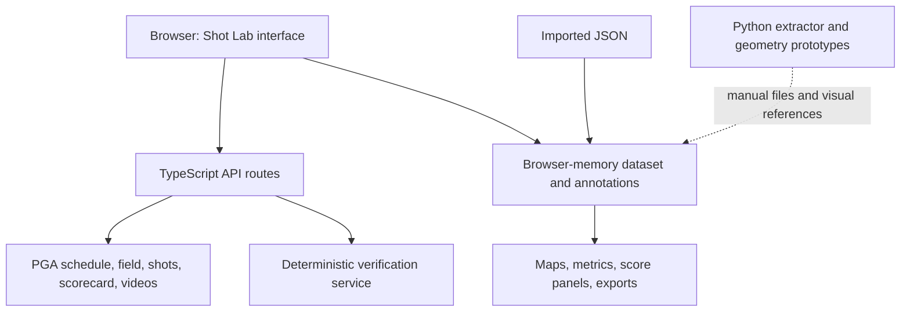

# TOURCAST Shot Lab — Full Program Breakdown and Recommended Changes

**Review date:** October 27, 2026  
**Hosted app:** https://tourcast-shot-lab-nick.shrewdfir128.chatgpt.site  
**Baseline:** Saved version 6; source commit `1706677a7a9a22f8221c77521b948e10c31b11af`  
**Scope:** Entire hosted app, server routes, calculation modules, tests, supporting Python extractor, drive renderers, and green-break prototype.

## 1. Overall assessment

TOURCAST Shot Lab already provides a usable private app: season/event/participant selection, shot retrieval, offline import, maps, shot details, video metadata, scoring verification, annotated putt calculations, and exports. The recent flight and green-break illustrations extend the project’s analytical possibilities, but remain separate Python prototypes.

The recommended direction is to strengthen and extend the existing TypeScript app. Do not build a replacement interface or introduce a Python backend solely to integrate these small geometry calculations. Port the proven calculations behind explicit source adapters and shared coordinate contracts, with the Python examples retained as comparison fixtures.

The strongest existing foundations are source preservation, separate score/tracking semantics, explicit putt units/timing, cautious video joins, missing-value handling, and deterministic verification. The largest gaps are source-format compatibility, imported identity, preservation of sessions, and integration of polynomial flight/sampled putting geometry.

This report recommends changes; none were applied to the app or published during this documentation task.

## 2. Current program structure

### Architecture

The last arrow represents manual interoperability, not deployed integration. Source images and official viewer/clip links are provider resources. Uploaded maps and browser state are not stored in a configured app database.

### Component inventory

| Layer | Current files / implementation | Responsibilities |
|---|---|---|
| Main app | `app/page.tsx` | Season/event/player/round controls, fetch/import, filters, tabs, browser state, annotations, downloads |
| Shot explorer | `app/shot-explorer.tsx` | Source-map/coordinate views, custom overlay, stroke selection, official viewer, metric/arc panels |
| Metric adapter | `app/shot-metrics.ts` | Alias lookup, provenance text, source endpoint extraction, supported sampled trajectory arrays |
| Video and putt UI | `app/shot-video-panel.tsx` | Match display, clip links, timing fields, confirmation, unit/timing/path inputs, reset/results |
| Calculation layer | `app/shot-video.ts` | Video identity/matching, availability semantics, planar distance/speed, timing/path validation, enrichment |
| Scoring | `app/scoring.ts`, `app/score-panel.tsx` | Official totals/to-par, tracking classification/coverage, score and verification presentation |
| Import/export shaping | `app/data.ts` | Flattening, record metadata, CSV serialization and formula-like-string protection |
| Catalog/roster | `app/catalog-data.ts` plus catalog/participants routes | Schedule normalization, event membership merge, availability/fallback notes |
| Upstream access | `lib/pga.ts`, query modules, API routes | Fixed-host calls, server credential, timeouts, gzip/base64 decoding, request/response identity checks |
| Verification | `lib/verification.ts` | Event/round/hole consistency checks and bounded official-page fetch |
| Hosting/runtime | `worker/index.ts`, Vite/Vinext config, hosting manifest | React/TypeScript app and server routes on Worker runtime |
| Database/storage scaffolding | Empty `db/schema.ts`; `d1` and `r2` null in hosting manifest | No application database or object-store persistence currently configured |
| Test definitions | Four `tests/*.test.mjs` suites | Data/CSV/API handling, metrics, video/putt behavior, scoring/catalog verification |
| Companion extractor | `tourcast-starter/pull_tourcast.py` | One player, selected rounds, timestamped raw JSON/CSV |
| Companion flight examples | `plot_drive.py`, `plot_hole14.py` | Radar polynomial evaluation and static three-view plotting |
| Companion green prototype | `green_break_feature.py` | Sampled path geometry, affine green-image fit, comparison PNG/JSON |

The app package specifies Node ≥22.13, pnpm 11.25.0, React 19.2.6, TypeScript 5.9.3, and Vinext 1.0.0-beta.5 with Vite. These are inspected package declarations, not recommendations to upgrade or claims about current ecosystem versions.

## 3. Complete feature and maturity breakdown

| Capability | Current maturity | Assessment |
|---|---|---|
| Private hosted app | Deployed app exists; owner-only current allowlist | Preserve current audience; no new access system is needed for this documentation work |
| Season and schedule selection | Implemented | Labeled bundled fallback is useful; historical years do not imply tracking coverage |
| Event participants | Implemented via field + leaderboard merge | Correctly avoids treating the fixed player lookup as event membership |
| Player-round shot retrieval | Implemented with scope validation/timeouts | Current live success was not retested in this audit |
| Optional radar/video fetch | Implemented | Optional-source warnings retain available shot results |
| Offline JSON import | Implemented | Good fallback; identity promotion and session replacement need attention |
| Filtering and shot table | Implemented | Search covers flattened content; table cap/export scope are documented |
| Source hole-image overlay | Implemented | Displays normalized source endpoints; dashed connectors are correctly distinguished from flight arcs |
| Custom image overlay | Implemented with manual bounds | Useful but not full georeferencing; bounds must use the plotted coordinate frame |
| Official viewer and external links | Implemented | Distinguish pending-request link from loaded-dataset map link |
| Sixteen metric slots | Implemented with provenance | Alias coverage misses observed fields; source unit coverage is partial |
| Generic sampled arc plot | Implemented for selected array shapes | “Measured trajectory” label exceeds the reader’s provenance checks |
| Official scoring and tracking separation | Implemented | Preserve scorecard authority and handling of non-STROKE records |
| Verification service | Implemented | Deterministic scoped consistency checks, not a general autonomous AI agent |
| Video joins and timing semantics | Implemented | Availability and motion timing remain separate; ambiguity is explicit |
| Putt confirmation and unit selection | Implemented | Appropriate user assertions; still not validated against actual frames |
| Endpoint distance / average speed | Implemented | Correct lower-bound labeling for curved travel |
| Timed-path distance / segment speeds | Implemented | Strict endpoints hinder real rounded source samples; analysis remains planar |
| Export/reimport of annotations | Implemented | Preserves inputs and recomputes enrichments; schema/version durability needs improvement |
| Persistent projects/history | Not implemented | Browser memory and manual exports only |
| Radar polynomial flight | Demonstrated outside app | Integrate into existing adapter and explorer |
| Sampled putting curvature/elevation | Demonstrated outside app | Integrate into selected-shot workflow with explicit provenance |
| Calibrated screenshot error | Not implemented | Current comparison is visual, not quantitative |
| Whole-green terrain/contours | Not implemented | Need spatial coverage and independent validation |
| Independent putt prediction | Not implemented | Requires surface, aim/speed/rolling assumptions, and held-out measured data |
| News/odds/player-biography dashboards | Not established by inspected app | Related supplied feeds do not automatically constitute implemented screens |

## 4. Concrete findings from inspected source

### A. The app and new renderers do not yet share a trajectory model

`trajectory()` reads a small set of explicit finite x/y/z arrays. The uploaded JSON stores flight as `radarData.ballTrajectory` polynomial coefficient arrays. The app preserves that field in flattened JSON form but does not evaluate it. Consequently, the app can say no measured trajectory is available while our Python renderer reconstructs a valid fitted flight.

**Recommendation:** support this exact provider format with unit/frame metadata and explicit distinction between provider radar fit, normalized model, sampled path, and endpoint connector. Retain each field’s source basis.

### B. Observed radar fields are missing from metric aliases

`metrics` recognizes `spinRate` but not `launchSpin`, and `flightTime`/`hangTime` but not `actualFlightTime`. The supplied hole 14 drive contains `launchSpin: 2691.65` and `actualFlightTime: 8`.

**Recommendation:** add explicit provider adapters and defined field precedence rather than broad ambiguous alias matching. Keep fitted interval 7.541 s distinct from reported rounded flight time 8 s. Preserve unknown units; do not silently promote inferred units to verified units.

### C. Bare imports lose useful identity in the app wrapper

The current import path wraps a direct decoded object with `meta: {}` and does not derive metadata from `tournamentId`, `playerId`, or `round`. This affects result labels, filenames, video association, and loaded-context external links even when identity is available in source data.

**Recommendation:** infer missing wrapper identity from the decoded object, validate it, reject conflicts, and label the metadata’s source. A full app export should round-trip without identity changes.

### D. Failed fetch behavior differs from README

The README says API failures preserve the previous dataset. Current `load()` clears `result` and `rows` before fetching; a failed request therefore leaves no prior dataset on screen. Changing request scope and starting an import also clears current work.

**Recommendation:** separate pending-request state from the active dataset. Retain the previous dataset with its original scope until a replacement succeeds; label pending versus active context. Revise documentation to match the chosen behavior and add a regression test.

### E. Timed paths require unrealistically exact endpoint equality for this sample

The app accepts path endpoints within 1e−6 coordinate units of source endpoints. Hole 14’s final sampled point is `(11925.242, 9210.303)`, while the source endpoint is `(11925.24, 9210.3)`. These differ by approximately 0.00361 source units, so directly reusing that path can be rejected despite its apparent association with the shot.

**Recommendation:** define a source-resolution-aware physical tolerance, report endpoint residuals, and preserve original samples. Do not silently snap or rescale paths. Tolerance must not permit joining another shot’s path.

### F. The arc heading claims more than input checks establish

The app heading says “Shot arc · measured trajectory,” while the parser validates shape/finiteness but does not establish measured provenance. Imported simulated points can satisfy that shape.

**Recommendation:** derive the heading from source provenance and show an unknown state when unsupported. The same principle applies to putting paths and future contour outputs.

### G. The green prototype has known sample-specific presentation

The green script uses “Shot 4 → cup,” always labels vertical change “downhill,” selects the first eligible putt, and has fixed screenshot handling. These are acceptable example shortcuts but not production defaults.

**Recommendation:** integrate calculations, not those hardcoded assumptions. Use the app’s selected shot, actual pin and endpoint, signed elevation, source classification, and explicit reference-image handling.

## 5. Proposed changes by priority

**P0:** Prevent misleading identity, metrics, and geometry. **P1:** Complete app integration and dependable workflows. **P2:** Extend evidence-backed analysis and scale. Priorities are recommendations, not completed work or schedule commitments.

### P0 — Correctness and source compatibility

| ID | Change | Existing target | Why | Acceptance criteria |
|---|---|---|---|---|
| A01 | Promote and validate imported identity | `page.tsx`, `data.ts` | Prevent unspecified or conflicting event/player/round context | Bare sample identifies correctly; conflicting wrapper/source scope is rejected |
| A02 | Add observed radar field mappings | `shot-metrics.ts` | Avoid blank spin/time despite valid source values | Hole 14 displays source spin and reported time with proper basis; total never becomes carry/roll |
| A03 | Introduce explicit coordinate/provenance contract | Metrics, map, putt and flight modules | Prevent normalized image positions becoming physical distances or simulated data becoming measured | Every geometry result names frame, units, classification and conversion basis |
| A04 | Replace generic measured heading | `shot-explorer.tsx` | Shape validation does not prove measurement | Simulated/fit/unknown fixtures render truthful headings |
| A05 | Handle endpoint precision explicitly | `shot-video.ts` | Source rounding currently blocks the supplied putt path | Sample path can be associated under documented tolerance; residuals exported; unrelated path rejected |
| A06 | Preserve discrepancy fields | Putt/flight enrichment | Displayed versus geometric distance differs | 47 in., about 50.03 in., and about 50.14 in. remain separate; no hidden rescaling |
| A07 | Retain active dataset until replacement succeeds | `page.tsx` | Avoid losing analysis on failed fetch/import | Failed replacement retains prior scoped data; stale requests never relabel it |

### P1 — Integrate the features into the app

| ID | Change | Suggested implementation | Acceptance criteria |
|---|---|---|---|
| A08 | Radar polynomial reconstruction | Pure TypeScript evaluator, using provider flight interval and named axes | Hole 10/14 curves reproduce Python fixture values within documented numeric tolerance |
| A09 | Flight views | Extend existing explorer with elevation/downrange and overhead views; add 3D only if useful | Auto-bounds; explicit aspect ratios/units; no forced flight-to-final-lie alignment |
| A10 | Native putting-path adapter | Convert `ballPath.path` and `secondsSinceStart` into analysis input while retaining source samples | Selected putt populates path support only after unit/classification confirmation; no fabricated timing |
| A11 | Green map and break panel | Use provider green asset, world-to-image transform, pin/chord/initial-direction layers | Selected shot drives every layer; missed finish stays separate from pin; transform residual labeled honestly |
| A12 | Elevation and grade panel | Port path-relative Z profile and signed endpoint grade | Uphill/downhill/level cases are correct; not labeled whole-green slope |
| A13 | Save/resume sessions | Start with explicit local save/export and restore; add persistent storage only if required | Annotations, selections, calibration and source identity round-trip; save location/scope clear |
| A14 | Robust map/reference handling | Explicit crop/calibration settings and useful empty states | Missing or mismatched image never silently looks aligned |
| A15 | Version exported schema | Add analysis version, source hash, source/derived separation and settings | Older app exports load predictably or provide migration errors |
| A16 | Regression coverage | Extend existing four suites; add bounded UI workflow checks | Import identity, failed replacement, endpoint tolerance, aliases and reconstruction cases covered |
| A17 | Performance diagnostics | Measure complete request and rendering paths | Identify redundant verification fetches; improve based on measurements rather than assumptions |

### P2 — Research and broader operation

| ID | Change | Prerequisite | Acceptance criteria |
|---|---|---|---|
| A18 | Calibrated screenshot comparison | Adequate point correspondences and suitable camera/terrain model | Held-out alignment error reported; pixel thickness/perspective uncertainty visible |
| A19 | Multiple-putt coverage view | Matched course, round/pin, coordinates and reconstruction classes | Sampled routes visible; unsampled areas remain unknown |
| A20 | Estimated local terrain / contours | Spatially diverse elevation evidence or surveyed surface | Independent validation and coverage mask; no whole-green inference from one route |
| A21 | Independent putt prediction | Validated surface and motion model; aim/speed/green-speed assumptions | Evaluate unseen measured paths, not the simulated inputs used to fit the model |
| A22 | Event-scale history and refresh | Verified roster/coverage, restartable jobs, storage decisions | Partial runs identify missing records; access failures never count as empty valid rounds |

## 6. Recommended app experience after integration

Keep the current season/event/participant/round workflow and three result tabs. Extend **Hole map & metrics** around its selected shot rather than introducing a second application.

Suggested analysis modes within that tab:

1. **Hole overview:** existing source map and endpoint connectors.
2. **Flight:** provider radar-fit reconstruction, metadata and source basis.
3. **Green / putting:** selected putt path, pin, endpoint chord, initial-direction reference where supported, break detail and elevation.
4. **Comparison:** external provider view or calibrated reference, with validation status.

Keep video timing and putt confirmation near their existing inputs. Distinguish reported metrics, user assertions, calculated outputs, and unavailable values. A fresh score-verification pass and geometric confidence are separate concepts.

These modes are proposed changes. Version 6 does not already contain the Python green-break/flight views.

## 7. Current backend endpoints

| Endpoint | Current role | Notes |
|---|---|---|
| `GET /api/status` | Whether server credential is configured | Does not test actual live access |
| `GET /api/catalog?season=YYYY` | Season schedule with labeled lookup fallback | No player score verification context |
| `GET /api/participants?event=RYYYYNNN` | Merge field and leaderboard membership | Retains alternates/withdrawals/recorded players |
| `POST /api/shots` | Shots, optional video metadata, scorecard, tracking, verification, enrichment | Fixed upstream host, timeouts, decoded-scope checks, no-store response |
| `POST /api/tourcast-shot-video` | Standalone video metadata and scoped verification | Optional hole/shot filters; availability semantics explicit |
| `POST /api/putt-analysis` | Planar putt calculation and optional scoped verification | The current UI annotates/recomputes locally; it does not need this route to apply its inputs |

Preserve the client/server boundary. Keep the PGA credential server-side. Avoid adding new endpoints for calculations that can safely share a pure TypeScript module between UI and server.

The verification service makes bounded HTTP requests and compares structured values. It is not a browser-control agent or an LLM-based assistant. Its code and the app’s existing tests are already part of the product and should be extended, not replaced by a new generic bot.

## 8. Suggested implementation sequence

| Stage | Deliverable | Exit condition |
|---|---|---|
| 1. Correctness | A01–A07 | Real sample imports with identity; honest provenance; supported radar fields; precision-aware path validation; replacement failures preserve context |
| 2. Analysis integration | A08–A12 | Hole 14 drive and putt views render inside the existing app with numerical parity to fixtures |
| 3. Workflow stability | A13–A17 | Save/restore and export schema are dependable; images/calibration have correct lifecycle; relevant tests pass |
| 4. Independent comparison | A18–A19 | Multiple routes and reference alignment have honest coverage/error reporting |
| 5. Terrain/prediction research | A20–A21 | Independent evidence supports surface and prediction validation |
| 6. Broader operation | A22 | Storage and refresh requirements justify and support event-scale use |

For a solo developer, stages 1–3 deliver the clearest near-term value. Adding databases, microservices, cloud job orchestration, or a separate Python service before these foundations would increase maintenance without resolving the identified issues.

## 9. Evidence and validation limits

### Sources inspected

- Hosted app’s saved version 6 and matching checked-out source commit.
- Main page, explorer, metric adapter, video/putt modules, score components, import/export functions.
- Catalog, participants, shots, video, status, and putt-analysis server routes.
- PGA access/decompression helpers and deterministic verification implementation.
- Hosting manifest, package declaration, Worker setup, empty database schema, and test definitions.
- Supplied starter extractor/source/README and both identical ZIPs.
- Current Python flight and green scripts, uploaded player-round JSON, source green image, screenshots, and computed metrics.

### Checks actually performed

Source commit matched the saved version-6 record. Both starter archives had identical SHA-256 values. Focused Python checks exercised flattening, help commands, and rejection of empty/coincident putting paths. Previous rendered images and calculation checks were available from this conversation. The round JSON contains 18 holes, 69 stroke records, 30 nonempty radar trajectory arrays, 17 sampled ball paths, and 28 records starting on `Green`.

The app’s existing test files cover data preservation/CSV/API handling, metrics, video/putt calculations, and scoring/catalog behavior. They were inspected, not rerun in this documentation-only checkout. No new browser walkthrough, full build, hosted live endpoint verification, screenshot calibration, or independent terrain survey was performed. Historical README validation statements are historical evidence, not newly reproduced results.

### Example review findings

| Observation | What it supports | What it does not establish |
|---|---|---|
| Hole 14 drive apex matches reported 127.1 ft | Consistency of polynomial reconstruction and inferred radar units | Course registration or bounce/roll accuracy |
| Five drive specs match after rounding | Metadata consistency with supplied displayed specs | Complete tracking coverage |
| Putt has 0.856 in. chord deviation and −2.31% endpoint grade | Geometry of this supplied simulated path under inferred course-foot units | Full green contours or independent measured break |
| TOURCAST close-up shows a subtle curve | Qualitative visual consistency | Calibrated inch-level agreement or independent ground truth |
| Near-zero affine control-point fit residual | Numerical consistency of reused coordinate pairs | Survey accuracy or held-out map alignment |

## 10. Implementation Notes

### Assumptions

The intended program is the existing TOURCAST Shot Lab app plus its supporting utilities. Version 6 is the documentation baseline. Proposed work should preserve its current private audience and source/derived-data separation.

### Risks

Unknown units, imported identity gaps, ambiguous source aliases, strict rounding tolerances, manual timing, and simulated geometry can create false confidence. Improving score verification does not validate shot geometry. A shared upstream simulation is not independent ground truth.

### Next Steps

Implement stage 1 in the existing app, then integrate the flight evaluator and sampled-putt adapter with parity fixtures. Keep the companion Python outputs as reproducible references. No implementation or publication is included in this report.

### Alternatives

Continue using separate Python renderers for research while the app handles data and annotations. For contour mapping, prefer surveyed terrain where available. For persistence, start with explicit export/restore before adopting managed database storage.

### Performance Considerations

Current text filtering serializes flattened rows; annotation updates re-enrich the dataset; raw view serializes the full wrapper. Measure browser costs with larger imports. Server verification can repeat upstream operations across requests; use scoped, bounded caching only with clear freshness rules. Small trajectory arrays do not justify parallel infrastructure by themselves.

### Maintenance Considerations

Keep provider adapters explicit, coordinate assumptions versioned, API secrets server-side, and regression fixtures small. Align README behavior with code. Record provenance and settings in exports, and keep actual app versions distinct from prototype ZIP suffixes.
